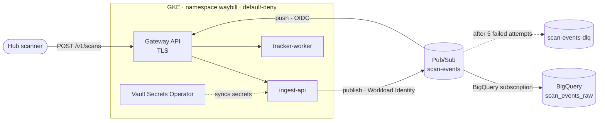
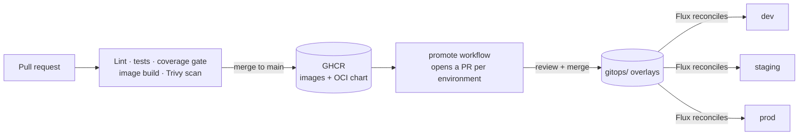

# waybill-platform

[](https://github.com/kevink4498/waybill-platform-demo/actions/workflows/services.yml)
[](https://github.com/kevink4498/waybill-platform-demo/actions/workflows/platform.yml)
[](https://github.com/kevink4498/waybill-platform-demo/actions/workflows/terraform.yml)

A reference delivery platform for a small event-driven product on Google Cloud: two services,
CI pipelines, a reusable Helm chart, FluxCD GitOps for three environments, and Terraform for
the data layer. Everything is secure by default and every release is a reviewed Git change.

**Waybill** is a made-up parcel-tracking product, kept deliberately tiny so the platform around
it is the interesting part. This is a personal portfolio project, written from scratch.

## Architecture





## What is in here

| Path | What it shows |
| --- | --- |
| `services/` | Two Python services with unit tests: validation and publishing (`ingest-api`), an idempotent, order-safe state machine (`tracker-worker`). Non-root multi-stage images with no package manager at runtime. |
| `.github/workflows/services.yml` | Change detection, matrix jobs per service, lint, tests with an 85% coverage gate, image build with cache, a Trivy scan that reports each finding as a run annotation and blocks the push, immutable tags. |
| `charts/microservice/` | One chart for every service: restricted security context, HPA, PDB, Workload Identity, Vault-synced secrets, Gateway API route, NetworkPolicy. |
| `gitops/` | Flux `HelmRelease`s with a Kustomize base and `dev` / `staging` / `prod` overlays; default-deny namespace and a ResourceQuota. |
| `.github/workflows/platform.yml` | `helm lint`, render and schema-validate the chart and every overlay with kubeconform, block mutable tags, publish the chart to an OCI registry. |
| `terraform/` | Modules for a Pub/Sub topic with dead-lettering, a partitioned BigQuery landing table, and Workload Identity; one root and one state per environment. |
| `.github/workflows/terraform.yml` | fmt, validate, tflint, Trivy config scan; plan on PR and apply on main through keyless OIDC, with an approval gate on prod. |
| `scripts/promote.sh` + `promote.yml` | Promotion as a pull request: copy a tag from one environment to the next, refuse anything that is not immutable. |
| `.github/dependabot.yml` | Weekly grouped updates for Actions, Python packages, base images and Terraform providers. |
| `docs/` | Architecture notes, decision records, and the release runbook. |

## Design choices

- **Git is the only way to change a cluster.** CI builds and publishes artifacts; it never runs
  `kubectl` or `helm upgrade`. Flux pulls. Rollback is `git revert`.
- **Immutable tags only.** Images are `main-<sha>`; overlays that reference anything else fail CI.
  What runs in an environment is always traceable to a commit.
- **No long-lived credentials.** Pods reach GCP through Workload Identity, CI reaches GCP through
  OIDC, and application secrets are synced from Vault. There is no key file or secret in this repo.
- **Least privilege at the resource, not the project.** `ingest-api` can publish to one topic.
  The Pub/Sub service agent can write to one dataset.
- **Deny by default.** The namespace blocks all traffic; each release opens only its own ingress
  from the gateway and egress to DNS and HTTPS. Pods run non-root with a read-only filesystem.
- **One chart, many services.** A new service is a `HelmRelease` and an overlay patch, not a new
  chart to maintain.
- **Environments differ only in overlays and tfvars.** Same chart, same modules, different sizes,
  retention and protection settings.

More detail: [docs/architecture.md](docs/architecture.md) · [docs/decisions](docs/decisions) ·
[docs/runbook-release.md](docs/runbook-release.md)

## Try it locally

```bash
# tests and lint
pip install -r services/ingest-api/requirements-dev.txt
make test lint

# run a service
cd services/ingest-api && uvicorn app.main:app --port 8080
curl -X POST localhost:8080/v1/scans -H 'content-type: application/json' \
  -d '{"tracking_id":"WB0000000042","status":"PICKED_UP","hub":"BLR-01"}'

# see exactly what Flux would apply to an environment
make render ENV=prod

# promote whatever dev runs into staging (edits the overlay; commit it as a PR)
scripts/promote.sh staging all --from dev
```

## Deploying it for real

The repository is complete but ships with placeholders, because it is not tied to a live project:

1. Replace the `waybill-<env>` project IDs and `example.com` hostnames in `gitops/` and
   `terraform/envs/` with your own.
2. Create the state buckets, then set the repository variable `GCP_WORKLOAD_IDENTITY_PROVIDER`
   to enable the Terraform plan and apply job.
3. Install the Gateway API, cert-manager and the Vault Secrets Operator on the cluster, then
   `flux bootstrap github --path=gitops/clusters/dev`.

## Status

All three workflows pass on `main`, and the `services` workflow publishes both scanned images to
GHCR. CI covers everything that can be checked without a cloud account: unit tests, chart and
overlay schemas, Terraform validation and security scans. The Terraform plan/apply job and the
Flux deployment have not been run against a live GCP project from this repository.

## License

MIT
